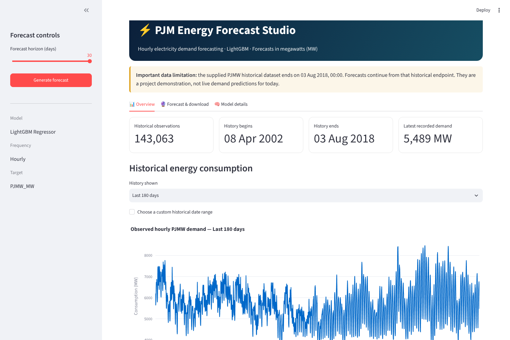
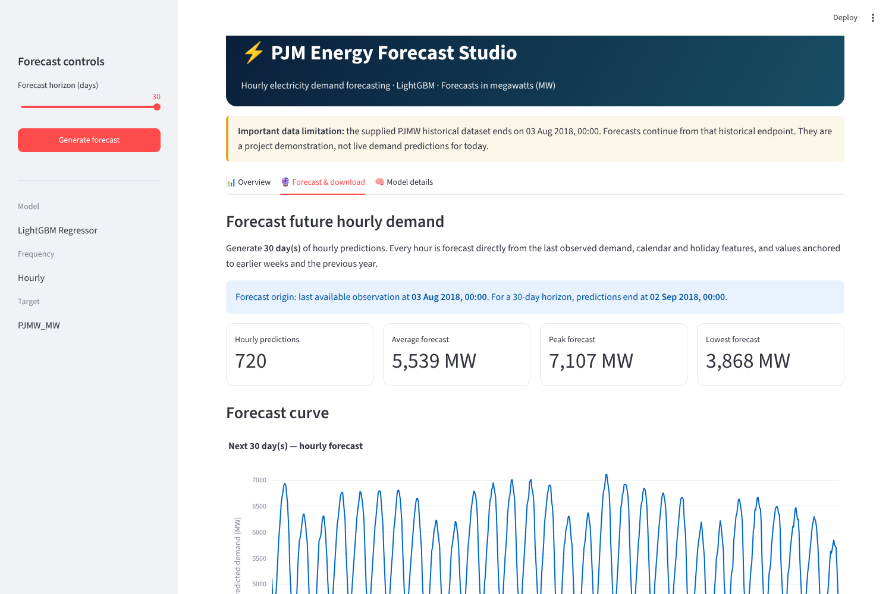
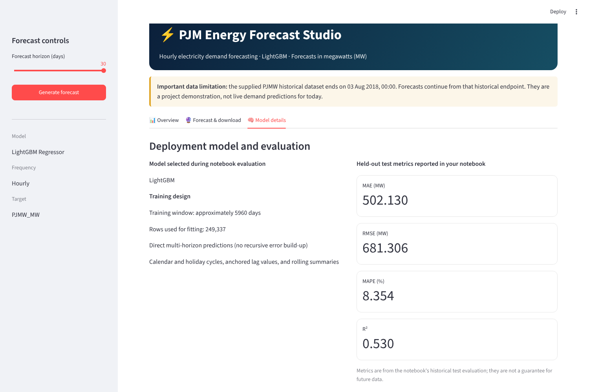

# ⚡ PJM Hourly Energy Consumption Forecasting

Hourly electricity demand forecasting for **PJM West (PJMW, in MW)** with a **30-day forecast**, built as a time-series project in Jupyter and deployed as a **Streamlit** app.

> Data note: the supplied dataset ends on **3 Aug 2018**, so forecasts continue from that date. This is a project demonstration, not a live demand forecast.

## Project goals
- Use the **last year as the test set** and build a forecasting model
- Find trends by hour of day, weekday/weekend, season, holidays and long-term level
- Forecast the **next 30 days (720 hours)**
- Deploy the best model in a Streamlit web app

## Approach
1. **EDA & cleaning** – duplicate DST timestamps consolidated, one missing hour filled, one 487 MW anomaly corrected; hourly, weekly, seasonal, holiday and long-term analysis.
2. **Modelling** – ARIMA, SARIMA, Decision Tree, XGBoost, LightGBM and an XGBoost+LightGBM blend, compared with a "same hour last week" benchmark. Settings tuned on **12 monthly validation windows**; the test year is used only for final confirmation.
3. **Direct multi-horizon forecasting** – every hour is predicted directly from the last observation, calendar/holiday features and values anchored to earlier weeks and the previous year (no recursive error build-up).
4. **Deployment** – best model saved with `joblib`; `model_deployment.py` is the backend, `app.py` the Streamlit front end. The notebook verifies the app backend reproduces its forecast exactly.

## Results (held-out test year, rolling 30-day forecasts)
| Model | MAE (MW) | RMSE (MW) | MAPE (%) |
|---|---|---|---|
| **LightGBM (selected on validation)** | **502.1** | **681.3** | **8.35** |
| XGBoost | 497.1 | 674.9 | 8.27 |
| Decision Tree | 500.5 | 668.5 | 8.45 |
| Weekly seasonal-naive benchmark | 628.6 | 827.4 | 10.62 |
| SARIMA | 744.6 | 911.8 | 13.42 |
| ARIMA | 748.7 | 927.2 | 13.12 |

Validation MAE of the selected model: **449.9 MW**. Remaining error is mostly weather-driven; adding temperature data is the main next step.

## App
| Overview | Forecast & download | Model details |
|---|---|---|
|  |  |  |

## Run locally
```bash
pip install -r requirements.txt
streamlit run app.py
```
Keep `app.py`, `model_deployment.py`, `PJM_selected_deployment_model.joblib`, `PJM_deployment_metadata.json` and `PJMW_MW_cleaned_hourly_history.csv` in the same folder.

To regenerate everything, run `PJM_Hourly_Energy_Consumption_Forecasting.ipynb` top to bottom (~15–20 min).

## Structure
```
├── PJM_Hourly_Energy_Consumption_Forecasting.ipynb   # EDA → modelling → deployment
├── app.py                                            # Streamlit app
├── model_deployment.py                               # forecasting backend
├── PJM_selected_deployment_model.joblib              # saved model
├── PJM_deployment_metadata.json / PJM_tree_feature_columns.json
├── PJMW_MW_cleaned_hourly_history.csv                # cleaned hourly history
├── PJMW_MW_Hourly.xlsx                               # raw dataset
├── PJM_Forecasting_Artifacts/                        # metrics, test & 30-day forecasts
├── screenshots/
└── requirements.txt
```

## Tech stack
Python · pandas · NumPy · statsmodels · scikit-learn · XGBoost · LightGBM · Matplotlib · Plotly · Streamlit
